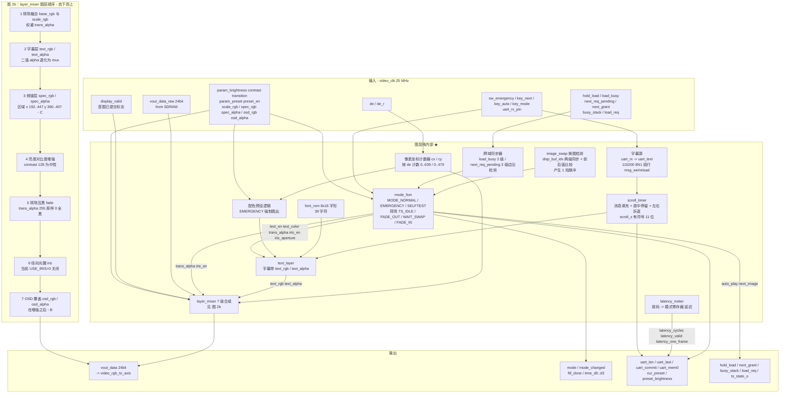
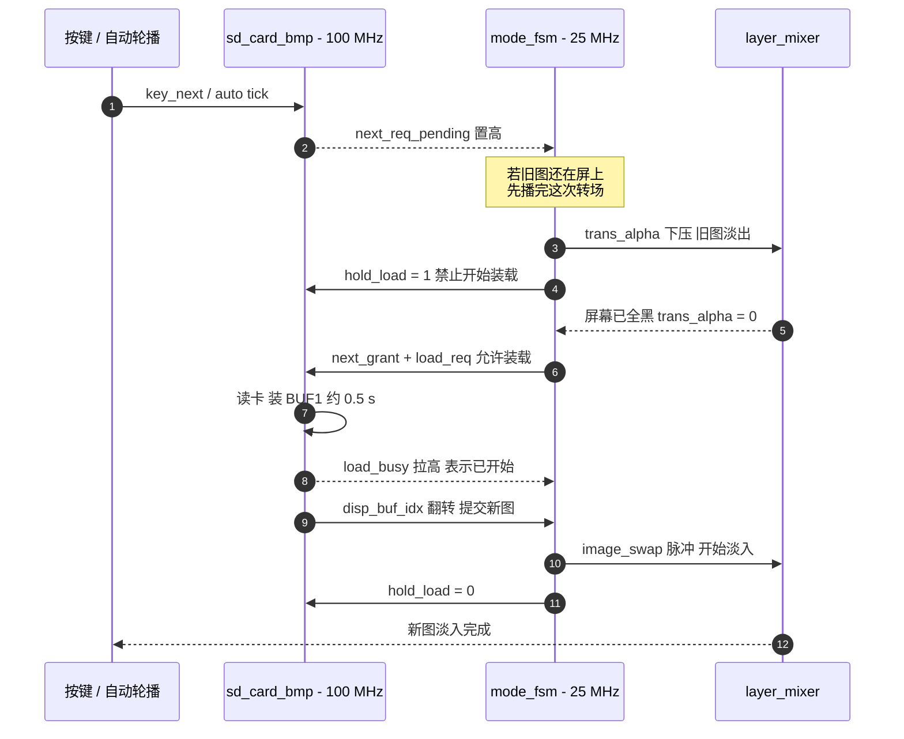
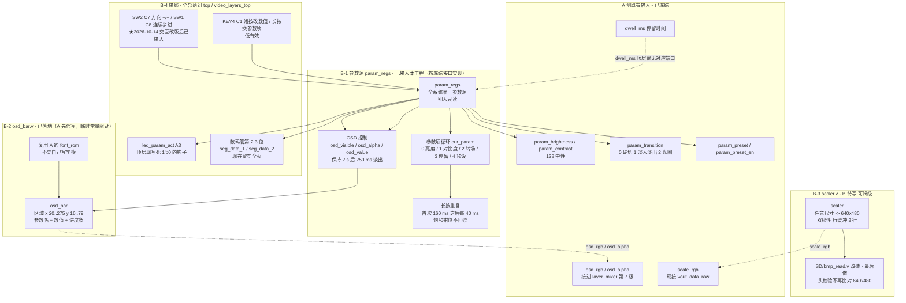

# base_withA 功能分块与框图（按功能分块 · Mermaid）

> 对象：`D:\ProgramData\TD\base_withA`（lab_ex5 基线 + Task A 图层包），板卡 HX4S20C / EG4S20BG256，工具 Anlogic TD 6.2.1。
>
> 本文件**只画结构**，不只写文字：先按功能分块，再给三张图。
>
> | 图 | 对象 | 粒度 |
> |---|---|---|
> | [图 1](#图-1整机功能分块框图) | 整机 | 8 个功能块 + 时钟复位 |
> | [拨码清单](#拨码开关清单哪些在用--哪些没用) | 板级开关 | 在用 / 没用 逐条判定（带约束与 HDL 证据） |
> | [图 2](#图-2a包图层栈video_layers_top) | A 包图层栈 | 像素流 / 状态机 / 两相转场握手 |
> | [图 3](#图-3task-b功能分块与接线) | Task B | 参数源 / OSD / scaler / 接线 |
>
> 依据（权威源，非估计）：`src/user_source/hdl_source/top_tf_hdmi_audio.v`、`video_layers_top.v`、`layer_mixer.v`、`mode_fsm.v`、`SD/sd_card_bmp.v`、`SD/bmp_read.v`、`doc/A包说明/接口契约与分工表.md`、`TaskB开发指南.md`。
>
> 图例：实线 = 已实现并接线；**虚线 = 已冻结接口但尚未接入**（端口存在、顶层接常量 0 或模块未写）；`★` = A 包新增。

---

## 图 1：整机功能分块框图

```mermaid
flowchart TB

  subgraph CLK["① 时钟与复位"]
    direction LR
    XTAL["外部 50 MHz 晶振<br/>clk"]
    SYSPLL["sys_pll<br/>clk0 100M sd_card_clk<br/>clk1 125M ext_mem_clk<br/>clk2 125M 180度 ext_mem_clk_sft"]
    VPLL["video_pll<br/>clk0 25M video_clk<br/>clk1 125M hdmi_5x_clk"]
    APLL["PLL_HDMI_AUDIO<br/>clk2 12.288M audio_mclk"]
    POR["POR 上电复位<br/>por_cnt 位19 约 21 ms"]
    RSTALL["rst_all<br/>= ~rst_n or ~por_done or ~audio_pll_lock"]
    XTAL --> SYSPLL
    XTAL --> VPLL
    XTAL --> APLL
    XTAL --> POR
    POR -->|por_done| RSTALL
    APLL -->|audio_pll_lock| RSTALL
  end

  subgraph HMI["② 人机输入"]
    KEY1["KEY1 A2 rst_n<br/>已补 PULLUP"]
    KEY2["KEY2 B2 手动下一张"]
    KEY3["KEY3 B1 轮播开/关"]
    KEY4["KEY4 C1 参数项切换<br/>短按=下一项 / 长按=只弹 OSD"]
    SW2["SW2 C7 sw_dir<br/>方向 +/−"]
    SW1["SW1 C8 sw_param_up<br/>按住=改数值（只有它改）"]
    SW3["SW3 C6 sw_emergency<br/>应急 高有效"]
    UART["PC 串口 CH340<br/>F12 115200 8N1"]
    SWFREE["未使用的拨码<br/>SW4 C5（C 的音频开关）<br/>契约已分配 板上未接"]
    SWHW["板上硬件开关 不进 RTL<br/>SW6 数码管/双色LED 二选一<br/>SW5 蜂鸣器"]
  end

  subgraph SDL["③ TF 卡读图链路 - sd_card_clk 100 MHz"]
    SDB["sd_card_bmp<br/>图数上限 15 / 双缓冲调度 / 应急选图<br/>扫描区 0..131071 扇区"]
    DEB["key_press_debounce x2"]
    SDTOP["sd_card_top<br/>sd_card_cmd + spi_master"]
    BMPR["bmp_read<br/>扫描步进 8 扇区<br/>头判据 BM+640+480+24"]
    SDESC["sd_card_sec_read_write"]
    SDB --> DEB
    SDB --> BMPR
    SDB --> SDTOP
    SDTOP --> SDESC
  end

  subgraph MEM["④ SDRAM 双缓冲帧缓存 - ext_mem_clk 125 MHz"]
    FRW["frame_read_write<br/>write BUF0/BUF1 = 0 / 307200"]
    FWR["frame_fifo_write<br/>写侧 sd_card_clk"]
    FRD["frame_fifo_read<br/>读侧 video_clk"]
    SDRAM["sdram<br/>sdr_init_ref + sdr_as_ram<br/>EG_PHY_SDRAM_2M_32"]
    FRW --> FWR
    FRW --> FRD
    FRW --> SDRAM
  end

  subgraph VID["⑤ 视频通路 - video_clk 25 MHz"]
    VTIM["video_timing_data<br/>产生 hs vs de + read_req/ack"]
    VDEL["video_delay<br/>延迟像素与同步头"]
    LAYERS["video_layers_top ★<br/>A 图层栈集成壳<br/>详见 图 2"]
    R2A["video_rgb_to_axis_640x480<br/>RGB/DE/VS 转 AXIS"]
  end

  subgraph AUD["⑥ 音频通路"]
    TONE["hdmi_audio_tone_i2s_64fs<br/>自发 8 音阶 48 kHz 测试音"]
    I2SR["I2S_receiver<br/>解串为 24-bit PCM"]
    ACR["audio_arc_calculate<br/>ACR 的 CTS / N"]
    TONE -->|bclk lrck dout| I2SR
    I2SR -->|audio_valid 左右声道| ACR
  end

  subgraph HDMI["⑦ HDMI 1.4b 发射"]
    EDID["startup_pulse<br/>上电触发一次 EDID 读取"]
    CORE["hdmi_1_4b_transmitter_core_wrapper<br/>加密 IP：EDID 组包 TMDS 编码<br/>VIC1 640x480 48K RGB"]
    PHY["hdmi_phy_wrapper<br/>lane_lvds_10_1 TMDS 10:1"]
    DDC["DDC I2C<br/>SCL / SDA"]
    EDID -->|edid_trig| CORE
    CORE --> DDC
    CORE -->|TMDS ch0 ch1 ch2 clk| PHY
  end

  subgraph DSP["⑧ 板级显示资源"]
    SEG["seg_scan<br/>seg_sel 6 位 / seg_data 8 位"]
    DEC["seg_decoder"]
    LED["4 个独立 LED<br/>A4 B12 A3 C10"]
    DEC --> SEG
  end

  %% ---- 时钟与复位 ----
  SYSPLL -->|sd_card_clk| SDB
  SYSPLL -->|ext_mem_clk| FRW
  SYSPLL -->|ext_mem_clk_sft| SDRAM
  VPLL -->|video_clk| VTIM
  VPLL -->|video_clk| VDEL
  VPLL -->|video_clk| LAYERS
  VPLL -->|hdmi_5x_clk| PHY
  APLL -->|audio_mclk| TONE
  RSTALL -.->|rst_all| SDB
  RSTALL -.->|rst_all| FRW
  RSTALL -.->|rst_all| VTIM
  RSTALL -.->|rst_all| TONE
  RSTALL -.->|rst_all| CORE

  %% ---- 输入 ----
  KEY1 --> POR
  KEY2 --> SDB
  KEY2 --> LAYERS
  KEY3 --> SDB
  KEY3 --> LAYERS
  KEY4 --> LAYERS
  SW3 --> LAYERS
  UART --> LAYERS

  %% ---- TF 卡物理口 ----
  SDESC -->|nCS DCLK MOSI| TFCARD["TF 卡 FAT32<br/>前 14 张轮播 + 末张应急"]
  TFCARD -->|MISO| SDESC

  %% ---- 读图到缓存 ----
  BMPR -->|write_req/write_en/write_data| FRW
  FRW -->|video_read_en/read_data| VDEL
  VTIM -->|read_req/ack| FRW

  %% ---- 视频到 HDMI ----
  VDEL -->|vout_data_raw| LAYERS
  LAYERS -->|vout_data 24bit| R2A
  R2A -->|AXIS user/valid/last/data/ready| CORE
  I2SR -->|audio_valid 左右声道| CORE
  ACR -->|acr_valid cts n| CORE
  PHY -->|HDMI_CLK_P D2_P D1_P D0_P| CONN["HDMI_B 接口<br/>视频 + 音频同口输出"]

  %% ---- A 层与卡的转场握手 ----
  LAYERS -.->|hold_load next_grant busy_stack load_req| SDB
  SDB -.->|load_busy next_req_pending| LAYERS
  LAYERS -->|display_valid| SDB
  SDB -->|disp_buf_idx 换图即淡入触发| LAYERS
  LAYERS -->|emg_sel = mode==EMERGENCY| SDB
  SDB -->|state_code| DEC
  SDB -->|img_found_o| DEC
  FROZEN["冻结未接端口<br/>param_* / osd_* / scale_* / spec_*<br/>顶层当前接常量"] -.-> LAYERS
  LAYERS -->|mode mode_changed latency_one_frame| LED
  SDB -->|state_code| SEG
```



### 图 1 分块说明

| 块 | 关键文件 | 一句话职责 | 时钟域 |
|---|---|---|---|
| ① 时钟与复位 | `top` 内联 + `IP/sys_pll.v`、`video_pll.v`、`PLL_HDMI_AUDIO` | 3 个 PLL 出 5 个时钟；POR 只依赖 50 MHz 晶振，等齐 PLL 再放 `rst_all` | — |
| ② 人机输入 | `top` 端口 | 按键 / 拨码 / 串口三路物理输入；**拨码里只有 C6 真的接进来了**（见上一节清单） | 外部 |
| ③ TF 卡读图 | `SD/sd_card_bmp.v`、`bmp_read.v`、`sd_card_top.v`、`spi_master.v` | 原始扇区扫描找 BMP、15 张上限、应急图=末张、两相转场调度 | `sd_card_clk` 100 M |
| ④ 帧缓存 | `SD/frame_read_write.v`、`frame_fifo_write/read.v`、`sdram.v` | 双缓冲，写 100 M / 读 25 M 跨域取帧 | `ext_mem_clk` 125 M |
| ⑤ 视频通路 | `video_timing_data`、`video_delay`、`★video_layers_top`、`video_rgb_to_axis_640x480` | 单进单出，A 的图层栈插在 `video_delay` 与 RGB2AXIS 之间 | `video_clk` 25 M |
| ⑥ 音频通路 | `hdmi_audio_tone_i2s_64fs`、`I2S_receiver`、`audio_arc_calculate` | 自生成 I2S 测试音 → 回环解串 → ACR | 12.288 M → 25 M |
| ⑦ HDMI 发射 | `hdmi1.4b_transmitter_core/`、`hdmi_phy_warpper.v`、`lane_lvds_10_1.v` | EDID/组包/TMDS 编码 + 10:1 串行化 | `video_clk` + `hdmi_5x_clk` |
| ⑧ 板级显示 | `SD/seg_scan.v`、`SD/seg_decoder.v`、4 个 LED | 6 位数码管 + 独立 LED（数码管与双色 LED 由 SW6 二选一） | 50 M `clk` |

---

## 拨码开关清单：哪些在用 / 哪些没用

**判定依据（可复核，不是转述）**

* `src/user_source/constraints_source/pin.adc` 里现有**三条拨码约束**：
  `sw_emergency`(C6, 第 61 行)、`sw_param_up`(C8)、`sw_dir`(C7) —— 只有 **SW4 / C5** 还没有约束。
* `hdl_source` 里 `sw_` 前缀的信号有 `sw_emergency` / `sw_param_up` / `sw_dir`（★ 2026-10-14 交互改版后新增后两者）。
* 所以"**契约里分给谁**"和"**板上真的接了谁**"是两回事 —— 下面两栏必须分开看。

| 手册名 | 引脚 | 契约归属 | 契约功能 | 板上 / RTL 现状 | 判定 |
|---|---|---|---|---|---|
| SW1 | **C8** | B | 按住 = 按当前方向连续步进 | `sw_param_up` 已接（约束带 PULLUP） | ✅ **在用**（★2026-10-14 由"参数 +"改） |
| SW2 | **C7** | B | **方向选择：拨上=+ / 拨下=−** | `sw_dir` 已接（原 `sw_param_dn`） | ✅ **在用**（★2026-10-14 由"参数 −"改） |
| SW3 | **C6** | A | 应急模式触发（拨上=应急） | `sw_emergency` 已接，`mode_fsm` 已读 | ✅ **在用**（承担模式切换，**未动**） |
| SW4 | **C5** | C | 音频可视化开关 `param_viz_en` | 无端口、无引脚约束（C 方向未实现） | ❌ **没用** |
| SW5 | — | 硬件 | 蜂鸣器开关 | 板上物理开关，与本设计无关 | ➖ 不参与设计 |
| SW6 | — | 硬件 | 数码管 / 双色 LED 二选一 | 板上乒乓开关，**它本身就是"切换"开关**，不进 RTL | ➖ 排除 |

**结论（按"除掉有切换功能的"这个口径）**

1. 排除 **SW6**（显示通道二选一，本身就是切换开关）和 **SW3**（应急模式切换，已在用）；
2. **真正没用的是 SW4（C5）** —— 契约里是 C 的"音频可视化开关"，C 方向尚未实现；
3. SW1/SW2 现在都在用（交互改版后：SW2 = 方向、SW1 = 连续步进）；
4. 板上唯一"完全没人认领"的物理开关是 **SW5（蜂鸣器）**，它通常被蜂鸣器占着，**不建议动**。

**顺带一个正好对得上的缺口**：`doc/A包说明/当前状态_验收记录.md` §8.2② 的"**拨码可切换效果类型**"缺一个物理开关来源 ——
RTL 已就绪（`param_transition` 已经被 `mode_fsm` 真正读取，顶层也早已接上 —— 见本文件图 3 的 `param_transition` 行与 `top` 的 `param_transition` 连接）。
现在空闲的只有 **SW4 / C5**（C 的，需先跟 C 确认）。

### 归属（契约原文，`接口契约与分工表.md` §5.2 第 254–269 行）

| 信号名 | 引脚 | **归属** | 契约功能 |
|---|---|---|---|
| `sw1` | C8 | **B** | 按住 = 按当前方向连续步进（★ 2026-10-14 改；原"参数 +"） |
| `sw2` | C7 | **B** | 方向选择：拨上 = +，拨下 = −（★ 2026-10-14 改；原"参数 −"） |
| `sw3` | C6 | **A** | 应急模式触发（**若不采用，则用作转场效果切换**） |
| `sw4` | C5 | **C** | 音频可视化开 / 关 |
| SW5 | — | 硬件 | 蜂鸣器开关 |
| SW6 | — | 硬件 | 数码管 / 双色 LED 二选一 |

三条容易漏掉的原文细节：

1. **约束落地的责任人是 B** —— 契约第 263 行原话："约束写法（**B 负责加入 `pin.adc`**）"，且给出了 4 条 `set_pin_assignment`。所以现在 `pin.adc` 里 4 条拨码只写了 C6 一条，**欠的是 B 那一份**。
2. **契约自己给 `sw3` 留了后手** —— 第 258 行写明：若 `sw3` 不用作应急，则用作**转场效果切换**。即"效果类型拨码"这个缺口，契约预设的答案就是 **C6**，而不是去动 C5。
3. **文档只有角色、没有姓名** —— 文末"附：签字"（第 411–417 行）三行全是空的（A/B/C 姓名、签字、日期均未填）。所以"归属 B / C"指的是**角色**，具体是谁得看你们组内怎么分工。

三方占用汇总（《板级接口与显示资源.md》第九部分）：A 占 1 拨码（C6）+ 2 按键；B 占 2 拨码（C8/C7）+ 1 按键（C1）；C 占 1 拨码（C5）+ 1 LED。

> ⚠️ 还有一个**命名坑**要提醒：《板级接口与显示资源.md》第 36 / 514 行把 **C1 写成 `key3`**，而 `top` 与 `pin.adc` 里 **C1 是 `key4`**（`key3 = B1`）。照旧文档接线会把 B 的参数项键接到 A 的轮播键上。

---

## 图 2：A 包图层栈（`video_layers_top`）

### 图 2a：模块与像素流



> `USE_TEXT=1`、`USE_SPEC=1`、`USE_ENHANCE=1`、`USE_FADE=1`、`USE_IRIS=0` 是 `video_layers_top` 里例化 `layer_mixer` 的实际参数值；`USE_IRIS=0` 是**实测后关掉的**（打开会把 `video_clk` 拉到 WNS -0.472 ns / 14 个失效端点）。

### 图 2c：两相转场握手（换图时到底谁等谁）



> 为什么必须两相：卡什么时候读完与按键时刻无关；若不等"屏幕全黑"就换缓冲，观感就是**硬切 + 末尾粘一段淡入**（上板实际报过这个现象）。
> `disp_buf_idx` 是**唯一的淡入触发点**——它由 100 MHz 域驱动，进 25 MHz 域必须先过两级同步器，再做"当前值 vs 上一拍值"比较；直接用未同步值比较会漏判（历史 bug）。

---

## 图 3：Task B（功能分块与接线）

> **`param_regs.v` 已接入本工程**：A 按《TaskB开发指南》§3 的冻结接口实现了一份 `src/user_source/hdl_source/param_regs.v`（B 的原件在 `C:\Users\jwen\Desktop\anlu\rtl`，那份跑过 47 项仿真；本工程这份没跑过仿真，接口逐字对齐以便原地替换）。原先 A 手写的"亮度加减"临时实现已删除 —— 参数只能有一个来源。下图虚线部分 = 仍未接的部分。



### 图 3 接线对照（端口 ↔ 引脚）

| B 的模块 / 端口 | 顶层落点 | 引脚 | 现状 |
|---|---|---|---|
| `param_regs.key_next_param` | `key4`（KEY4 = **C1**） | **C1** | ✅ 已接；**★2026-10-14 最终行为**：**短按 = 切换到下一参数项**；**长按（≥0.6 s）= 只弹出 OSD**（不换项、不改值）；**KEY4 不改数值**。⚠️ 指南 §8 的片段写成 `key3`（本工程 `key3`=B1 轮播），别照抄，见风险 1 |
| `param_regs.sw_up` | 顶层端口 `sw_param_up` | **C8** | ✅ 已加（约束带 PULLUP）。**★2026-10-14**：按住 = 按当前方向改数值，**只有它才改数据**（160 ms/40 ms 原手感） |
| `param_regs.dir_up` | 顶层端口 `sw_dir`（原 `sw_param_dn`） | **C7** | ✅ **★2026-10-14 新增/改名**：方向选择，拨上 = +，拨下 = −（原"参数 −"）；引脚与 PULLUP 不变 |
| `param_regs.brightness` | `.param_brightness` | — | ✅ 已接。**2026-10-13 语义升级**：预设给基调（工作 40%→102、应急 50%→128），参数是相对偏移（128 = 不偏移） |
| `param_regs.contrast` | `.param_contrast` | — | ✅ 已接。同上（工作 60%→153、应急 100%→255） |
| `param_regs.transition` | `.param_transition` | — | ✅ 已接（原写死 `2'd1`）→ **"拨码切效果类型"从此成立** |
| `param_regs.preset / preset_en` | `.param_preset` / `.param_preset_en` | — | ✅ 已接（原写死 `2'd0` / `1'b0`） |
| `param_regs.dwell_ms` | 送到了 `osd_bar` 显示 | — | ⚠️ **轮播计时还没有下游**：要真的改变轮播间隔，得给 `sd_card_bmp` 加一个 dwell 输入（A 的模块） |
| `param_regs.cur_param / osd_visible / osd_alpha / osd_value` | `.cur_param` / `.osd_visible` / `.osd_alpha` / `.osd_value` | — | ✅ 已接（OSD 的弹出/保持 2 s/淡出由 `param_regs` 管） |
| `param_regs.activity` | `led_param_act` | **A3** | ✅ 已接（原写死 `1'b0`） |
| `osd_bar.osd_rgb / osd_alpha` | `.osd_rgb` / `.osd_alpha` | — | ✅ 已接通（`layer_mixer` 的 `USE_OSD` 默认 1；坐标由 `video_layers_top` 导出 `pix_x/pix_y`） |
| 数码管第 2、3 位（参数值） | `seg_scan` 的 `seg_data_1` / `seg_data_2` | SW6 二选一 | ⬜ **仍是 B 的活**：A 没有占用这两位的权限，屏幕上目前靠 OSD 显示参数值 |
| `scaler.scale_rgb` | `.scale_rgb` | — | 顶层接 `vout_data_raw`（绕过缩放） |
| `osd_bar` 显示区 | `video_layers_top` 无该几何参数 | — | 需定 `OSD_X/Y/W/H`（约定 y 16..79） |
| `led_param_act` | 已有端口 | **A3** | 顶层 `assign led_param_act = 1'b0;` |
| 数码管第 2、3 位 | `seg_scan` 的 `seg_data_1` / `seg_data_2` | SW6 二选一 | 写 `{1'b1,7'b1111_111}` 全灭 |

### 图 3 的坐标分区（三方别打架）

```
y  16 ~  79   B 的 OSD 参数条
y 360 ~ 407   C 的音频频谱（SPEC_X 192, SPEC_W 256）
y 424 / 448   A 的字幕两行（居中 32 字符 x 10 px 字宽）
```

---

## 风险与待确认（画图时发现的，不是猜的）

| # | 事项 | 证据 | 影响 |
|---|---|---|---|
| 1 | **B 的参数项按键名对不上** | `TaskB开发指南.md:432` 写 `.key_next_param (key3)` 注释 `C1`；但 `top` 里 `key3 = B1`、`key4 = C1`，且《接口契约》§5.1 把 **C1** 分给 B 的"参数项选择"、B1 分给 A 的轮播开关 | 照抄那一行会把 B 的参数项抢到 A 的轮播键上，必须三方确认 |
| 2 | 拨码切效果类型尚未生效 | `top:492` `.param_transition (2'd1)`；`param_transition` 在 `mode_fsm` 里已被真正读取 | 验收条款"拨码可切换效果类型"目前只能靠 B 接入后才成立；空闲拨码可选 **SW4/C5**（见「拨码开关清单」） |
| 3 | 光圈效果不可显示 | `video_layers_top:719` `.USE_IRIS (0)`，理由是把 `video_clk` 打到负 slack | 效果类型 2 已实现但不可选；要先给 `dxr/dyr` 打拍 |
| 4 | `clkc[2]` 约束漏项 | `timing.sdc` 只 `rename_clock` 了 `clkc[0]/[1]` | `ext_mem_clk` 组 WNS **-6.699 ns** / 122 失效端点 |
| 5 | 两组 CDC 未约束 | `clk → audio_mclk`、`sd_card_clk → video_clk`（`display_valid` 直引） | 负 slack；`display_valid` 严格说应打拍 |
| 6 | 上板未验证、仿真未重跑 | README §8.4 / §9.5（`tb_task_a` 有 1 个 FAIL 未清零） | 本文件只描述结构，不代表功能已验 |

---

## 下一步（说一声就继续）

1. **图 1 时序版**：把 5 个时钟域的跨域点逐条画出来（含同步器级数、负 slack 标注）。
2. **接口契约图**：以《接口契约与分工表》§4 的 4 个冻结接口为主线，标 A/B/C 归属与只读/可写。
3. **Task B 接入补丁清单**：按图 3 的虚线项，逐条列出"改哪个文件、加哪几行、几个引脚约束"。
