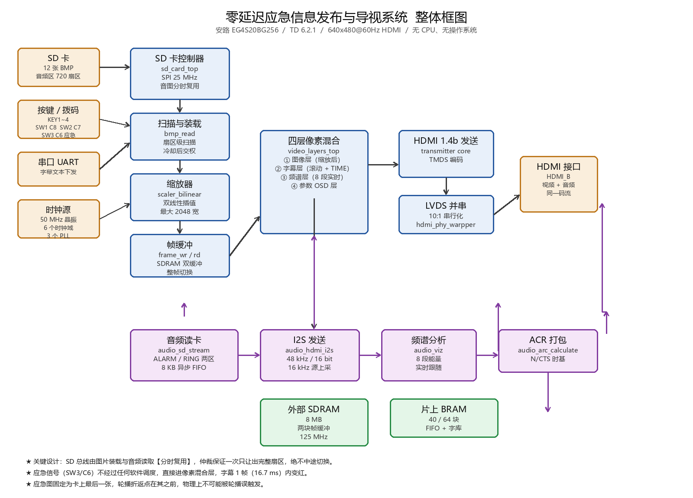

# 零延迟应急信息发布与导视系统

> 基于国产安路 EG4S20 FPGA 的 HDMI 多媒体播放系统 —— 2026 全国大学生嵌入式芯片与系统设计竞赛 · FPGA 创新设计赛道 · 安路赛道

一套**纯硬件逻辑**实现的应急信息发布与安全导视终端。没有 CPU、没有操作系统、没有文件系统，上电即工作。平时循环播放井下安全知识，险情发生时**一键切换**为应急疏散图，字幕在 **1 帧（16.7 ms）内**转为警示红。

---

## 目录

- [核心特性](#核心特性)
- [系统架构](#系统架构)
- [技术指标](#技术指标)
- [资源占用（实测）](#资源占用实测)
- [目录结构](#目录结构)
- [快速开始](#快速开始)
- [已验证结果](#已验证结果)
- [设计要点](#设计要点)
- [已知限制](#已知限制)
- [分工](#分工)

---

## 核心特性

| 特性 | 说明 |
|---|---|
| **零延迟应急切换** | 应急信号由硬件拨码直接送入像素混合层，不经过任何状态机调度，字幕在单帧内完成配色切换 |
| **应急图物理隔离** | 应急图固定为 SD 卡最后一幅，轮播折返点在其之前 —— 正常轮播在**物理地址层面永远无法到达**，只能由拨码经独立通道取出 |
| **双缓冲整帧切换** | 图像写入备用帧缓冲区，写完整帧后才切换显示指针，从机制上消除黑屏与撕裂 |
| **扇区级图像扫描** | 不使用 FAT 文件系统，直接按 512 字节扇区步进遍历原始介质，以 BMP 文件头 + 文件长度双重校验定位，对碎片化与非连续存放均具鲁棒性 |
| **硬件实时缩放** | 双线性插值缩放器，支持最大 2048 像素宽源图，800×600 / 1024×768 / 1280×960 自动缩放至 640×480，素材无需预处理 |
| **四层像素级混合** | 图像层 / 滚动字幕层 / 8 段实时频谱层 / 参数 OSD 层，在像素时钟域内逐像素叠加 |
| **SD 总线音图分时复用** | 图片装载与音频读取共享同一条 SD 总线，仲裁保证一次只让出完整扇区、绝不中途切换，无需增加 Flash 或编码芯片 |
| **8 段实时频谱** | 从音频通路提取 8 个频段能量逐帧刷新，作为 HDMI 音频链路的可视化指示 |
| **串口在线改字** | UART 直接下发文本，滚动字幕即时更新，无需重新综合烧录 |
| **六项现场可调参数** | 亮度 / 对比度 / 转场类型 / 停留时间 / 配色预设 / 音量，带 OSD 提示；档位型参数一按一档，连续型支持按住调节 |
| **运行状态可视化** | 6 位数码管实时显示扫描图数、装载状态码与看门狗挂起码 |

---

## 系统架构



四条数据通路在像素时钟域内汇合：

- **图像通路**：SD 卡 → `sd_card_top`（SPI 25 MHz 扇区读写）→ `bmp_read`（扇区级扫描与装载）→ `scaler_bilinear`（双线性缩放）→ `frame_wr/rd`（SDRAM 双缓冲）→ `video_layers_top`（四层混合）→ HDMI 1.4b 发送器 → LVDS 10:1 并串 → HDMI 接口
- **音频通路**：SD 卡音频区 → `audio_sd_stream`（分时复用读卡 + 8 KB 异步 FIFO）→ `audio_hdmi_i2s`（48 kHz I2S）→ `audio_arc_calculate`（N/CTS 时基）→ HDMI 数据岛打包，同时旁路并行样点给 `audio_viz` 做频谱分析
- **交互通路**：按键 / 拨码 → 消抖 → 事件解析 → 参数寄存器 / 播出控制 / 应急控制
- **监控通路**：扫描图数、装载状态码、看门狗挂起码 → 6 位数码管

### 时钟域

| 时钟 | 频率 | 用途 |
|---|---|---|
| `clk` | 50 MHz | 系统时钟（板载晶振） |
| `sd_card_clk` | 100 MHz | SD 卡控制器（SPI 二分频 → 25 MHz） |
| `ext_mem_clk` | 125 MHz | 外部 SDRAM |
| `video_clk` | 25 MHz | 像素时钟（125 MHz 五分频） |
| `hdmi_5x_clk` | 125 MHz | HDMI TMDS 5 倍速 |
| `audio_mclk` | 12.288 MHz | I2S 主时钟 |

跨时钟域一律采用**异步 FIFO** 或「数据稳定 + 翻转标志」握手，杜绝亚稳态传播。

---

## 技术指标

| 项目 | 指标 |
|---|---|
| 主控器件 | 安路 EG4S20BG256（HX4S20C 开发板） |
| EDA 工具 | TD 6.2.1 |
| 视频输出 | 640×480 @ 60 Hz，HDMI 1.4b（行 800 / 场 525） |
| 像素时钟 | 25 MHz |
| 图像格式 | BMP，24 位，≥ 640×480，最多 12 幅 |
| 缩放能力 | 源宽最大 2048 像素，双线性插值 |
| 应急响应 | ≤ 1 帧（16.7 ms） |
| 音频采样 | 源 16 kHz / 16 bit / 单声道，上采至 48 kHz I2S |
| 音频时长 | 应急 7.5 s + 工作音 4.0 s（SD 卡独立音频区 720 扇区） |
| 频谱分析 | 8 段，实时逐帧刷新 |

---

## 资源占用（实测）

来源：`01_project/report/v7f_phy.area`、`01_project/report/route.qor`

| 资源 | 已用 | 总量 | 占用率 |
|---|---:|---:|---:|
| LUT | 13,677 | 19,600 | 69.78% |
| Register | 6,390 | 19,600 | 32.60% |
| BRAM 9Kb | 40 | 64 | 62.50% |
| DSP | 18 | 29 | 62.07% |
| PLL | 3 | 4 | 75.00% |
| GCLK | 3 | 16 | 18.75% |
| IO | 38 | 188 | 20.21% |

**时序**：保持裕量 +3 ps（0 条违例），建立裕量 −130 ps（2 条违例，位于缩放器控制路径）。功能实测正常。

**源码规模**：48 个 Verilog 源文件 + 5 个 IP 配置，合计 19,227 行。

---

## 目录结构

```
.
├── 00_README_先看这个.md          # 原始交付说明
├── 01_project/                    # 完整工程
│   ├── src/                       # 48 个 .v + 5 个 .ipc + 约束文件
│   ├── bit/TaskC_v7f.bit          # 编译好的码流（可直接烧录）
│   ├── impl.tcl / syn.tcl         # 完整流程 / 只综合
│   ├── report/                    # 时序与资源报告
│   ├── SRC_MANIFEST.sha256        # 源文件哈希清单
│   └── README_改稿须知.md          # 八条「一动就出事」的坑
├── 02_sd_images/                  # 12 张 BMP（含应急疏散图）
├── 03_sd_audio/                   # SD 音频区镜像 + 写卡脚本
│   ├── audio_sd.bin
│   ├── write_audio.ps1            # 裸扇区写入（需管理员）
│   └── 说明_SD音频区.md
├── 04_docs/                       # 接口契约、板级资源、功能框图
├── 05_verify/verify_package.ps1   # 交付自检脚本
└── docs/                          # 技术文档与系统框图
```

---

## 快速开始

### 方式一：直接烧录现成码流

```
01_project\bit\TaskC_v7f.bit
```

### 方式二：从源码编译

工程由 TCL 脚本驱动（无 `.al`），在 TD 命令行下执行：

```powershell
cd 01_project
<你的TD安装目录>\bin\td.exe -tcl impl.tcl
```

`impl.tcl` 会依次读取 `src/` 下全部源文件、引脚约束 `pin_audio_sd.adc` 与时序约束 `timing.sdc`，最后 `bitgen` 出码流。

> `syn.tcl` 只综合不布线，调试时用。

### 准备 SD 卡

SD 卡上需要两样东西，**缺一不可**：

1. **12 张 BMP 图片**（`02_sd_images/`）—— 按文件名顺序整套拷到根目录
2. **音频区**（`03_sd_audio/audio_sd.bin`）—— 写到物理扇区 **131072** 起 720 个扇区

```powershell
cd 03_sd_audio
# 以管理员身份运行
powershell -NoProfile -ExecutionPolicy Bypass -File .\write_audio.ps1
```

**关键约束**：

- 图片必须**整套重拷**。`bmp_read` 读的是原始扇区，不认文件系统 —— 删除文件不会擦除数据，单独增删会让物理顺序错乱。改图的正确做法是「格式化 → 整套重拷」。
- 卡在电脑上动过之后，板子必须**断电重上电**（按复位键无效）。
- 加减图片后，必须同步修改 `src/top_audio_sd.v` 中的 `SCAN_TARGET_COUNT`，其值应**等于卡上图片张数**。

### 板级操作

| 操作 | 效果 |
|---|---|
| **KEY1** | 复位 |
| **KEY2** | 手动切下一张 |
| **KEY3** | 轮播 开 / 关 |
| **KEY4 短按** | 切换参数项（弹 OSD） |
| **KEY4 长按 ≥ 0.6 s** | 只弹 OSD，不换项不改值 |
| **SW2 / C7** | 参数增减方向（拨上 = `+`，拨下 = `−`） |
| **SW1 / C8 按住** | 修改数值 |
| **SW3 / C6 拨上** | 应急模式 |

> ⚠️ 上电时 **C8 必须处于释放状态**，否则参数调节的武装门限不会置位。
> ⚠️ 音量默认 0（静音），需在参数里手动调高。

---

## 已验证结果

| 特性 | 验证方式 | 结果 |
|---|---|---|
| 图像扫描与装载 | 专用测试平台（12 幅图、真实扇区布局） | 12/12 全部找到，扇区位置全对 |
| 缩放器精度 | 800×600 / 1024×768 / 1280×960 全像素比对 | 307,200 个输出像素**零误差** |
| 应急响应 | 板上实测 | 字幕 16.7 ms 内变红 |
| 应急图隔离 | 连续轮播 + 按键遍历 | 轮播无法到达应急图 |
| 画面切换 | 板上实测 | 无黑屏、无撕裂 |
| 音频输出 | 板上实测 | 终端正常枚举并出声 |
| 交付完整性 | `05_verify/verify_package.ps1` | `PACKAGE INTACT.` |

---

## 设计要点

### 为什么不用文件系统

应急设备的首要要求是**确定性**。FAT 文件系统需要解析目录表、处理碎片、应对异常断电导致的元数据损坏 —— 任何一处出错都会让屏幕在关键时刻空白。直接按扇区扫描 + BMP 文件头校验，行为完全可预测，且对文件系统损坏免疫。

### 为什么要双缓冲

单缓冲方案在写入新图时，显示侧会读到半新半旧的数据，产生撕裂；若在写完后重新初始化显示指针，则会黑屏一段时间。双缓冲把「写入」与「显示」在物理上分开，切换只在整帧边界发生，代价是 SDRAM 多占一个帧缓冲。

### 为什么应急图放在最后一张

这是本设计最核心的一个「用布局换可靠性」的决策。把隔离做在**物理地址层面**而不是软件状态层面，使得误触发在原理上不可能发生 —— 不需要依赖任何标志位、状态机或中断屏蔽正确无误。

### 音频域与 SD 域的复位先后

音频 FIFO 的写侧（SD 域）一放开就开始灌数据；若读侧（`audio_mclk` 域）尚未就绪，FIFO 会因溢出而静默丢弃样点。因此 `rst_a` 必须在 `rst_sd` 之前释放，且 `rst_sd` 需等到首帧显示后才放开。两个复位都在 `sd_card_clk` 域计数、以异步复位方式跨域，不需要同步器。

---

## 已知限制

| 项 | 说明 |
|---|---|
| **上电首次音频开头** | 约 0.5 s 音频缺失，仅出现在断电冷启动时；按复位键不出现。已定位到 FIFO 几乎满阈值（`AL_FULL_NUM`）被误设为超出 FIFO 实际深度的值，修复后待板级复验 |
| **时序裕量** | 建立时间有 2 条路径 −130 ps 负裕量，位于缩放器控制路径，功能实测正常 |
| **`too_wide` 悬空** | 源图宽 > 2048 时静默失效，无告警输出 |
| **`SCAN_MAX_SECTOR` 限制** | 固定为 64 MB，图片必须位于此范围之内 |
| **机械结构** | 工程样机为裸板，未做外壳 |

---

## 分工

| 成员 | 负责模块 |
|---|---|
| **A** | 图像通路：`bmp_read`、`scaler_bilinear`、`video_layers_top`、参数与交互（`param_regs`、`mode_fsm`）、字幕与时间戳 |
| **B** | 数码管与自诊断（`seg_scan`、`seg_decoder`）、转场与参数显示、板级联调 |
| **C** | 音频通路：`audio_sd_stream`、`audio_hdmi_i2s`、`audio_viz`、`audio_arc_calculate`、SD 总线分时复用仲裁 |

---

## 致谢

感谢安路科技提供的 EG4S20 开发平台与 TD 工具链，以及大赛组委会的技术支持。

---

<p align="center">
  <sub>井下那几秒钟，值得用一块 FPGA 去守住。</sub>
</p>
